# How Data and Copy Get Onto the CHP Site

**What it covers:** where your files live, what happens after you change one, and what the site checks before anything goes live.

> Day-to-day editing instructions (column definitions, tokens, worked examples) are in **[CONTENT-GUIDE.md](CONTENT-GUIDE.md)**. This page is the overview.

---

## Contents

1. [The short version](#1-the-short-version)
2. [Who owns what](#2-who-owns-what)
3. [From your change to the live site](#3-from-your-change-to-the-live-site)
4. [Local development vs. production](#4-local-development-vs-production)
5. [How one indicator card is assembled](#5-how-one-indicator-card-is-assembled)
6. [What the build checks](#6-what-the-build-checks)
7. [Data team: the file contract](#7-data-team-the-file-contract)
8. [Content team: the copy deck](#8-content-team-the-copy-deck)
9. [Narrative sentences: how tokens get filled](#9-narrative-sentences-how-tokens-get-filled)
10. [Suppressed and small-sample values](#10-suppressed-and-small-sample-values)
11. [Ground rules](#11-ground-rules)
12. [Open items](#12-open-items)

---

## 1. The short version

- **All data, metadata and copy live in one separate, public GitHub repo** (the "data repo"), not in the site code.
- **You edit files there.** A merge to `main` automatically rebuilds the site.
- **The build pulls your files, checks them, and produces a static site.** Nothing is fetched live in the visitor's browser.
- **If a check fails, the build stops and the current live site stays up.** A broken file never reaches visitors.
- **The data arrives ready to display.** Ranking, percent scaling and suppression are done in the export, not in the site code.

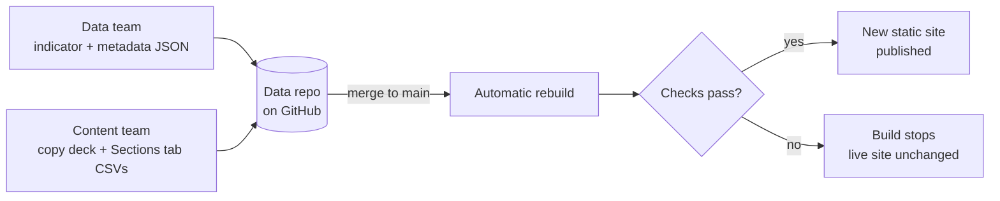

---

## 2. Who owns what

Every field has exactly one home. If two places seem to say the same thing, the one in this table wins.

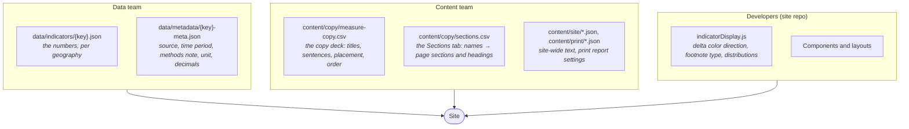

| What | File | Owner |
|---|---|---|
| Values for each CD, borough and citywide | `data/indicators/{key}.json` | Data team |
| Source, time period, methods note, unit, decimals, age adjustment | `data/metadata/{key}-meta.json` | Data team |
| Card title, Context and Comparison sentences, type/of/detail/units, which section a card is in, card order | `content/copy/measure-copy.csv` | Content team |
| Category and section names, ids and headings | `content/copy/sections.csv` | Content team |
| Header, footer, About page, glossary, standard phrases | `content/site/*.json` | Content team |
| Print-only differences | `content/print/printSettings.json` | Content team |
| Whether "higher" is good or bad, footnote type, distribution segments | `src/config/presets/indicatorDisplay.js` | Developers |

> The metadata files also carry `Section`, `Subsection`, `type`, `of`, `detail` and `units` fields. **The site ignores those** and uses the copy deck's values, so placement and wording are set in one place.

---

## 3. From your change to the live site

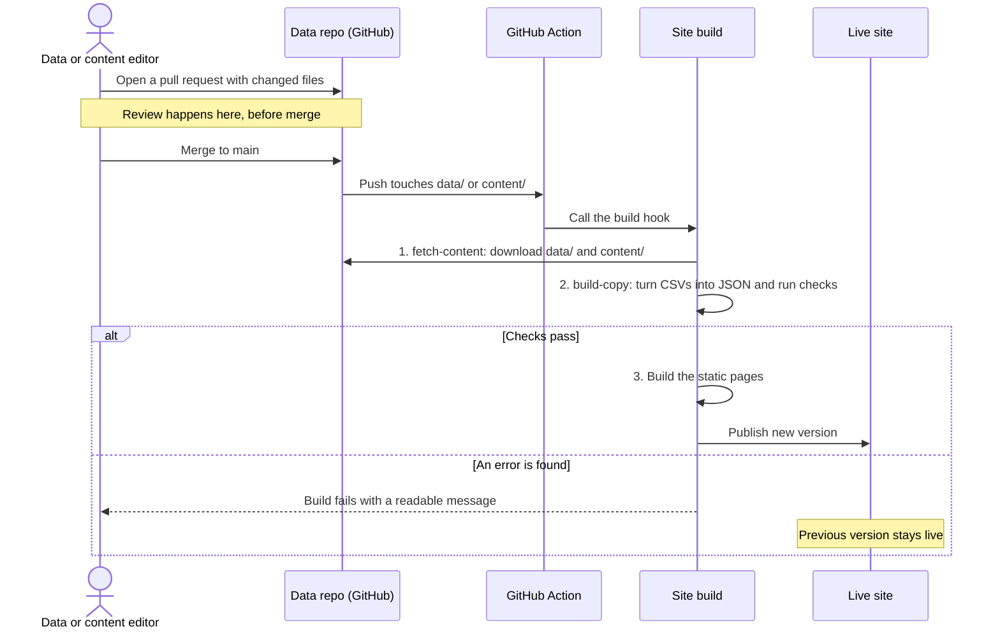

**What each step does**

| Step | Script | What happens |
|---|---|---|
| 1. Fetch | `scripts/fetch-content.js` | Downloads the data repo at `main`. `data/indicators/` and `data/metadata/` are **replaced** completely, so a file deleted in the data repo also disappears from the site. `content/` is copied over the top. |
| 2. Build copy | `scripts/build-copy.js` | Reads the copy deck and Sections tab, checks every row against the data files, and writes the three generated JSON files the site reads (see [section 6](#6-what-the-build-checks)). |
| 3. Build site | `next build` | Renders every neighborhood, indicator and print page as static files. |

**Only pushes that touch these folders trigger a rebuild:** `data/indicators/`, `data/metadata/`, `content/`. A rebuild can also be started by hand from the Actions tab.

**Timing:** the site is rebuilt once per merge. Bundle related changes into one pull request so they go live together (for example, a new data year plus the copy that mentions it).

---

## 4. Local development vs. production

The site code reads the same local folders in both cases. The only difference is whether the fetch step runs first.

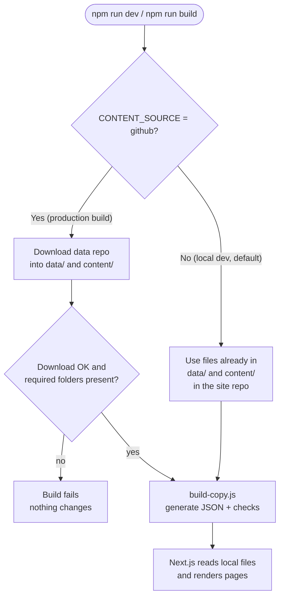

| | Local development | Production |
|---|---|---|
| Where files come from | Site repo's own `data/` and `content/` | Data repo on GitHub, pulled at build time |
| Turned on by | Nothing (default) | `CONTENT_SOURCE=github`, `CONTENT_REPO=owner/repo`, optional `CONTENT_REF` (branch, tag or commit) |
| Use it for | Previewing a change before you open a pull request | The live site |

**To preview a change locally:** drop the new files into the site repo's `data/` or `content/` folders and run `npm run dev`. The copy checks run automatically.

---

## 5. How one indicator card is assembled

Three files from two teams meet on each card, joined by the indicator **key** (for example `obesity`).

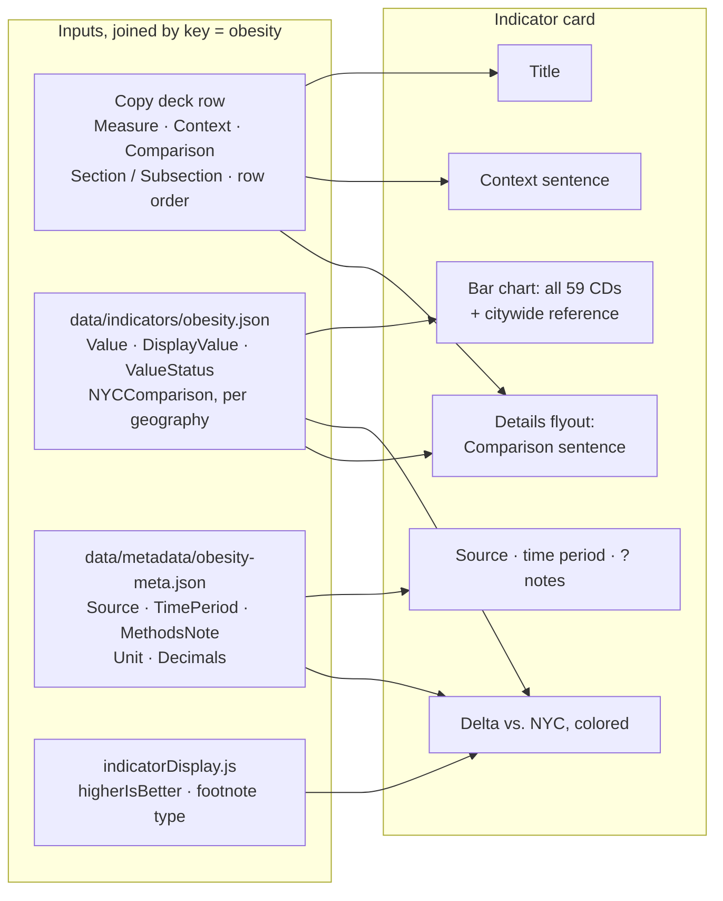

- **The card shows the Context sentence only.** The Comparison sentence appears only in the Details flyout.
- **Placement comes from the copy deck.** Which section a card sits in, and its order within that section, follow the deck's `Section`/`Subsection` and row order.
- **Delta units come from metadata.** `Unit: "%"` makes the delta read in percentage points ("pts"); `Decimals` sets its precision.

---

## 6. What the build checks

`build-copy.js` runs on every dev start and every build. **Errors** stop the build and nothing is written. **Warnings** print but still build.

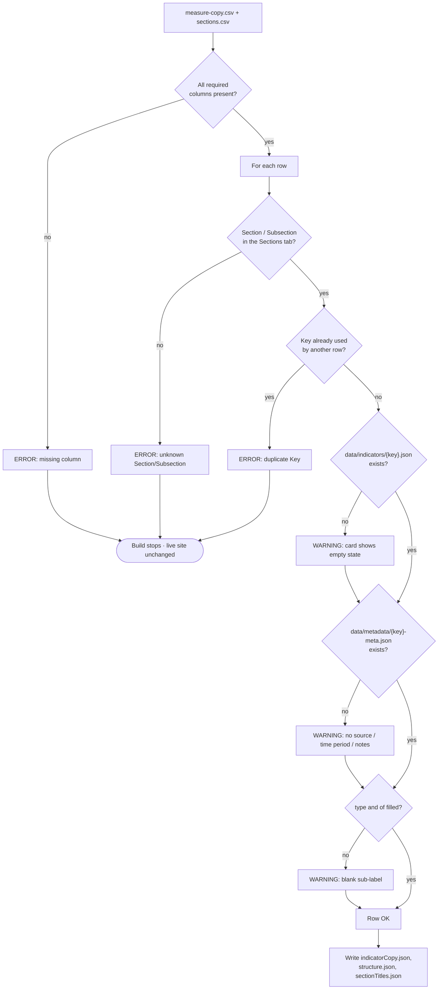

| Message | What to do |
|---|---|
| `missing column(s)` | The sheet export dropped or renamed a header. Restore it exactly. |
| `unknown Section/Subsection "X" / "Y"` | Typo, or the subsection isn't in the Sections tab yet. Fix the name or add the row. |
| `duplicate Key "x"` | Each key can appear once. Clear the extra row's Key. |
| `no data/indicators/{key}.json` | Data file missing or the key is misspelled. |
| `no data/metadata/{key}-meta.json` | Usually a `.meta.json` vs `-meta.json` naming slip. |
| `blank type/of` | Fill both columns in the copy deck. |

Full troubleshooting table: [CONTENT-GUIDE.md §13](CONTENT-GUIDE.md#13-troubleshooting-npm-run-copy).

---

### Pull request checks and notifications (data repo)

Every pull request in the data repo is checked by `scripts/validate-content.js` (settings in `scripts/validate-config.json`). It posts one comment with three parts: **Must fix** (blocks merging), **Needs review** (a reviewer adds the `warnings-reviewed` label to sign off) and **What this change does**. Problems that were already on main are listed separately and don't block. After a merge, the site is test-built before publishing; if that fails, the live site is left alone, a `build-failure` issue is opened and Teams is alerted. Setup: [data-repo-template/README.md](data-repo-template/README.md).

Run the same checks locally with `npm run validate`.

---

## 7. Data team: the file contract

### File layout in the data repo

```
data/
  indicators/{key}.json        one file per indicator (or per segment, see below)
  metadata/{key}-meta.json     one file per indicator, dash not dot
content/
  copy/measure-copy.csv        content team
  copy/sections.csv            content team
  site/*.json                  content team (optional)
  print/printSettings.json     content team (optional)
```

`data/indicators/`, `data/metadata/` and `content/copy/` are **required**. If any is missing, the build fails on purpose.

### Indicator file — `data/indicators/{key}.json`

```json
{
  "Section": "health-conditions",
  "Subsection": "chronic-conditions",
  "IndicatorKey": "obesity",
  "Data": [
    { "GeoType": "Citywide", "GeoID": 0,   "Geography": "NYC",       "Value": 0.26, "DisplayValue": "26%", "ValueType": "estimate", "NYCComparison": "na" },
    { "GeoType": "Borough",  "GeoID": 2,   "Geography": "Bronx",     "Value": 0.39, "DisplayValue": "39%", "ValueType": "estimate" },
    { "GeoType": "CD",       "GeoID": 101, "Geography": "Financial District", "Value": 0.08, "DisplayValue": "8%", "ValueType": "estimate", "NYCComparison": "lower" }
  ]
}
```

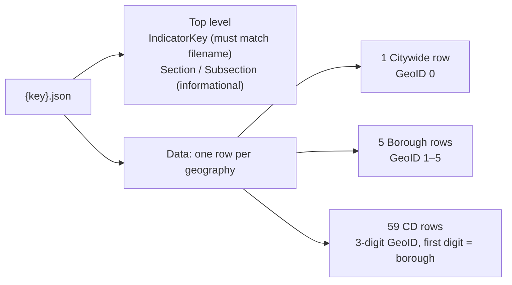

| Field | Rule |
|---|---|
| `IndicatorKey` | Once at the top of the file, matching the filename. Not repeated per row. |
| `GeoType` | `CD`, `Borough` or `Citywide` |
| `GeoID` | `0` citywide · `1–5` borough (1 MN, 2 BX, 3 BK, 4 QN, 5 SI) · 3-digit CD, e.g. `101`, `503` |
| `Value` | The number used for sorting, bars and deltas. **Percents as 0–1 fractions** (0.26 = 26%). `null` when suppressed. |
| `DisplayValue` | Exactly what appears on screen: `"26%"`, `"39%*"`, `"suppressed"` |
| `ValueStatus` | `flagged` for small samples; suppressed / `na` for no value |
| `NYCComparison` | Optional `higher` / `lower` / `similar` / `na`, the statistical test result. Fills the "higher than NYC" wording. |
| `LCLValue`, `UCLValue` | Optional confidence limits |

**Split indicators** ship as several files the site joins: age (`age0to17.json` … `age65plus.json`), race/ethnicity (`race-*.json`), cancer types (`cancer-{type}-{count|rate}.json`), premature-death causes (`premature-mort-cause-{cause}-{count|rate}.json`).

### Metadata file — `data/metadata/{key}-meta.json`

| Field | Shown as |
|---|---|
| `Source`, `TimePeriod` | Source line on cards, flyout, indicator page, print report |
| `MethodsNote`, `AgeAdjustment`, `DenominatorSource` | The "?" notes dialog |
| `Unit` | `%` switches deltas to percentage points |
| `Decimals` | Decimal places for deltas |
| `Subtitle` | Fallback card subtitle when no narrative is ready |
| `Title`, `Label` | Fallback titles (the copy deck's `Measure` wins) |

### How the site reads your files

**Unlike the copy deck, data files are not converted.** There's no build step that rewrites them and no generated data file. The site reads `data/indicators/` and `data/metadata/` directly at build time, so what you deliver is exactly what gets read. That's why the format above matters, and why reshaping (ranking, scaling, suppression) belongs in the export.

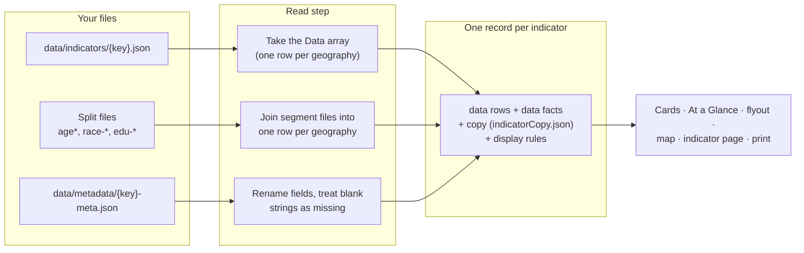

**1. Indicator files.** For each key the site opens `data/indicators/{key}.json` and takes its `Data` array. The top-level `Section`/`Subsection` are ignored, because placement comes from the copy deck.

| If… | Then |
|---|---|
| The file is missing | The card shows an empty state. `npm run copy` warns at build time. |
| The file isn't valid JSON | Same empty state, plus an error in the build log |
| A row has `Value: null` | That neighborhood gets no bar and no sentence (see [section 10](#10-suppressed-and-small-sample-values)) |

**2. Split indicators.** These keys have no single file. The site reads each segment file and joins them into one row per geography, holding a list of `{ key, value, displayValue }`, one entry per segment:

| Shown as | Files joined |
|---|---|
| `age-distribution` | `age0to17`, `age18to24`, `age25to44`, `age45to64`, `age65plus` |
| `race-ethnicity` | `race-latino`, `race-white`, `race-black`, `race-asian`, `race-other` |
| Education level card | `edu-did-not-complete-hs`, `edu-hsgrad-some-college`, `edu-college-degree-and-higher` |
| Cancer types, premature-death causes | `cancer-{type}-{count\|rate}`, `premature-mort-cause-{cause}-{count\|rate}` |

Age and race take their source and time period from one segment's metadata (`age0to17-meta.json`, `race-asian-meta.json`), so keep those consistent across segments.

**3. Metadata files.** The site opens `data/metadata/{key}-meta.json` and maps its fields (`Source` → source, `TimePeriod` → time period, and so on).

- **Blank strings count as missing.** `"Unit": ""` means "no unit", not a real value. This is why `avertable-death` and `edu-hsgrad-some-college` currently lose their `%`.
- **`Decimals: 0` is kept** as a real value.
- `Section`, `Subsection`, `type`, `of`, `detail` and `units` in metadata are ignored; the copy deck wins.

**4. The merged record.** Each indicator's data rows, metadata, copy-deck row and display rules are combined into one record. Every part of the site reads that record, so a value fixed in your file is fixed everywhere at once.

**What the site still computes from `Value`.** It keeps this to presentation:

| Computed | From | Note |
|---|---|---|
| Bar order (low → high) | CD `Value`s | Sorting only |
| Delta vs. NYC | CD and citywide `Value` | In points ("pts") when `Unit` is `%`; precision from `Decimals` |
| Percent axis labels | `Value` × 100 | Because percents arrive as 0–1 fractions |
| Borough reference | Median of that borough's CDs | **Only if your file has no borough row.** Send borough rows to avoid this. |
| "higher / lower / similar" | `NYCComparison` | Falls back to a ±5% rule only when the field is missing or `na`. Send it. |
| Top cancer types and causes | The split files | Temporary, until pre-ranked files arrive |

### Updating to a new data year

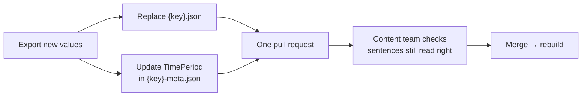

---

## 8. Content team: the copy deck

**The copy deck decides what appears, where, in what order, and what it says.** The Sections tab maps the deck's names to page sections.

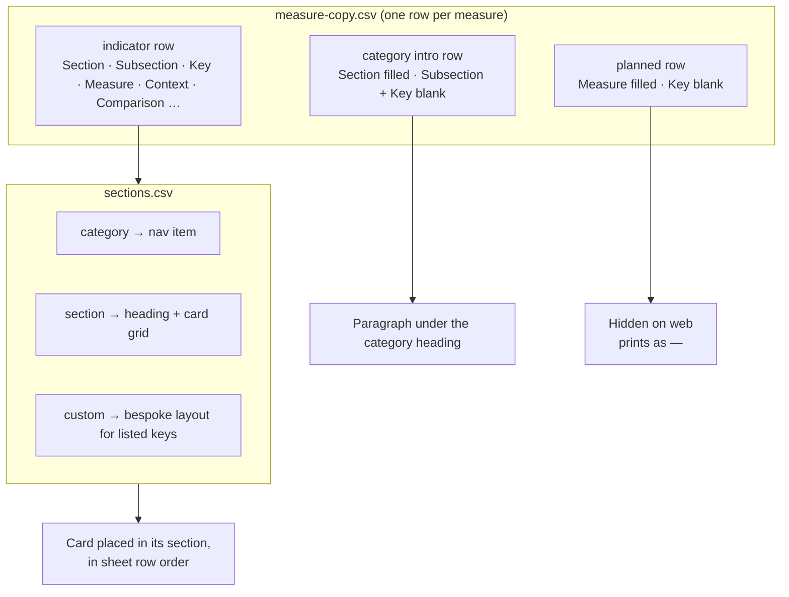

### The two source files

Both are CSV exports of tabs in the copy-deck spreadsheet. Header names must match exactly.

**`content/copy/measure-copy.csv`: the copy deck.** One row per measure.

| Column | Holds |
|---|---|
| `FLAG` | Editorial note. `category intro` marks an intro row; anything else is just a note. |
| `Section` | Category name (`Social`, `Healthcare`…) or `At a glance` |
| `Subsection` | Section within the category (`Economic`…). Blank for At a glance and intro rows. |
| `Key` | Indicator key, matching the data and metadata filenames. Blank = planned measure. |
| `Measure` | Card title, nav and search label |
| `Context` | "Why it matters" sentence. On the card and the flyout. |
| `Comparison` | Neighborhood sentence with `<TOKENS>`. Details flyout only. |
| `type`, `of`, `detail`, `units` | Sub-label pieces: `Percent` · `adults 18+` · `with obesity` · `per 100,000` |
| `indicatorDetail` | Extra definition in the details view |

```csv
FLAG,Section,Subsection,Key,Measure,Context,Comparison,type,of,detail,units,indicatorDetail
,Social,Economic,poverty,Poverty,Living in high-poverty neighborhoods limits…,"In <Name>, <SUM(Value Percentage)> of residents live in poverty…",Percent,people,below NYC's poverty threshold,,Calculated based on income…
```

**`content/copy/sections.csv`: the Sections tab.** One row per category, section or custom layout.

| Column | Holds |
|---|---|
| `Level` | `category` (nav item), `section` (heading + card grid) or `custom` (bespoke layout) |
| `Section`, `Subsection` | The names used in the copy deck. They must match exactly. |
| `Id` | Page anchor and nav id (`economic`) |
| `Heading` | On-page heading. Blank = use the Subsection name. |
| `Keys` | Custom rows only: the keys that layout draws, `;`-separated |

```csv
Level,Section,Subsection,Id,Heading,Keys
category,Social,,social,,
section,Social,Economic,economic,,
custom,,,avertable-deaths,Avertable Deaths,avertable-death
```

### The three generated files

`npm run copy` writes these on every dev start and build. **Don't edit them by hand**; they're overwritten each time.

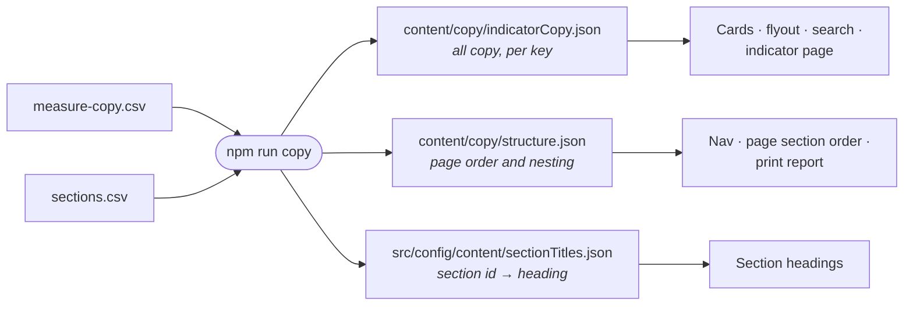

| File | Shape | Used for |
|---|---|---|
| `indicatorCopy.json` | One entry per key: the deck row's columns in lowercase (`measure`, `context`, `comparison`, `type`…) plus `topic`, the section id it renders in. Rows without a key go under `_unmapped`. | Card titles and sentences, Details flyout, search, `/indicator/{key}` |
| `structure.json` | `atAGlance`: list of keys. `categories`: each with `id`, `label`, `intro` and `sections`, each section listing its `rows` (keys, or `planned` measures) in sheet order and any custom layouts inside it. | Nav, the order of sections and cards on the page, print report |
| `sectionTitles.json` | Flat map of section id → heading (`"economic": "Economic"`) | Section headings |

`indicatorCopy.json` entry, for example (trimmed; real entries also carry `flag` and `navSection`, the nav item a card highlights, which differs from `topic` only for cards drawn by a custom layout):

```json
"poverty": {
  "key": "poverty",
  "topic": "economic",
  "section": "Social",
  "subsection": "Economic",
  "measure": "Poverty",
  "context": "Living in high-poverty neighborhoods limits…",
  "comparison": "In <Name>, <SUM(Value Percentage)> of residents live in poverty…",
  "type": "Percent", "of": "people", "detail": "below NYC's poverty threshold", "units": "",
  "indicatorDetail": "Calculated based on income and necessary expenses."
}
```

### Common edits

| You want to… | Do this |
|---|---|
| Change a sentence | Edit `Context` or `Comparison` in the deck |
| Move a card to another section | Change its `Section`/`Subsection` |
| Reorder cards | Reorder rows in the deck |
| Hold a sentence while it's in review | Leave `Context`/`Comparison` blank until it's approved. The card shows its plain subtitle. (`FLAG` is a note only; it doesn't hold anything back.) |
| Plan a measure that has no data yet | Add the row with a blank `Key` |
| Rename a heading | Change `Heading` in the Sections tab |

**Never rename a live `Key`.** It's part of shareable links (`/indicator/{key}`).

Column-by-column reference and worked examples: [CONTENT-GUIDE.md §4–7](CONTENT-GUIDE.md#4-the-copy-deck--column-reference).

---

## 9. Narrative sentences: how tokens get filled

Sentences in the deck can contain `<TOKENS>`, carried over from the Tableau copy deck. They are filled in for each neighborhood from that indicator's data file.

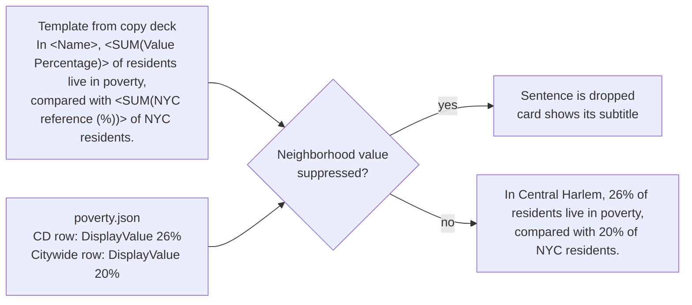

| Token | Becomes |
|---|---|
| `<Name>` | Neighborhood name |
| `<SUM(...)>`, `<AVG(...)>`, `<MIN(...)>`, `<Value>` | The neighborhood's `DisplayValue` |
| Anything with `NYC reference` | The citywide `DisplayValue` |
| `<AGG(NYC comparison)>` | `higher` / `lower` / `similar` from `NYCComparison`, worded per `phrases.json` |
| `<AGG(Estimate description ...)>` | Most / Many / Some / Few |
| `<Reliability>` | `*` when the row is flagged |

Tokens pull from `DisplayValue`, so **whatever the export puts in `DisplayValue` is exactly what readers see in the sentence.** If a token is misspelled or unsupported, the whole sentence is dropped and the card shows its subtitle. In local dev, the browser console names the template.

---

## 10. Suppressed and small-sample values

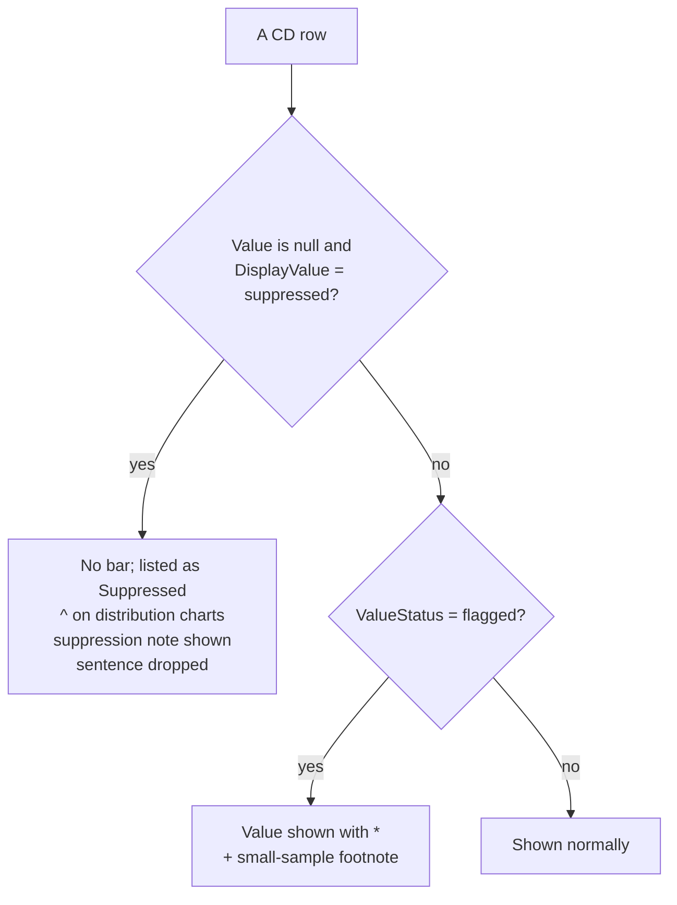

The footnote wording depends on the indicator's source type:

| Source type | Footnote |
|---|---|
| Survey (e.g. Community Health Survey) | *Interpret estimate with caution due to small sample size. |
| Administrative, rate | *Interpret rate with caution due to small number of events. |
| Administrative, percent | *Interpret proportion with caution due to small number of events. |

---

## 11. Ground rules

| Do | Don't |
|---|---|
| Deliver data already ranked, scaled and suppressed | Expect the site to compute rankings or convert units |
| Name metadata `{key}-meta.json` | Use `{key}.meta.json` (it's never read) |
| Keep `IndicatorKey` matching the filename | Rename a key that's already live |
| Put wording and placement in the copy deck | Put wording in metadata and expect it to show |
| Send related changes in one pull request | Edit the generated JSON files (`indicatorCopy.json`, `structure.json`, `sectionTitles.json`). They're overwritten on every build. |
| Preview locally with `npm run dev` before merging | Merge straight to `main` without review |

---

## 12. Open items

| Item | Owner | Status |
|---|---|---|
| Create the public data repo and move `data/` and `content/` into it | Dev + data team | To do |
| Add the rebuild workflow to the data repo (template: `scripts/data-repo-trigger-site-rebuild.yml`) and store the build hook URL as a repo secret | Dev | To do |
| Point the production build at the data repo (`CONTENT_SOURCE`, `CONTENT_REPO`) | Dev | To do |
| Data team becomes the single source for all data and metadata | Data team | Agreed in principle |
| `Unit` is blank in metadata for `avertable-death` and `edu-hsgrad-some-college`; both are percents | Data team | To fix |
| Pre-ranked files for cancer types and premature-death causes (the site ranks these itself for now) | Data team | To do |
| One structured label field per cause/cancer-type file, in place of names in `MethodsNote` prose | Data team | To do |
| Confirm `direction` (higher is better or worse) and source type (survey vs. administrative) can come from metadata, so they move out of site code | Data team | To ask |
